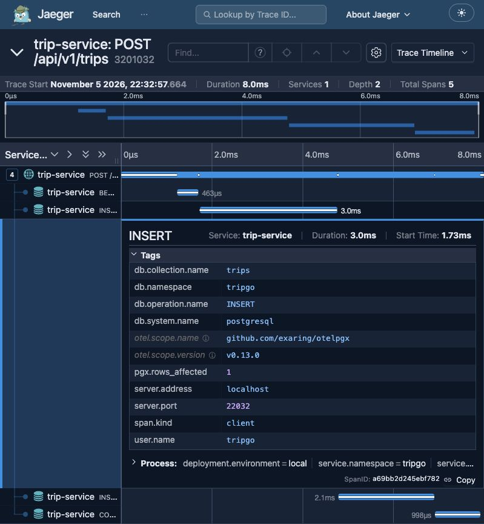
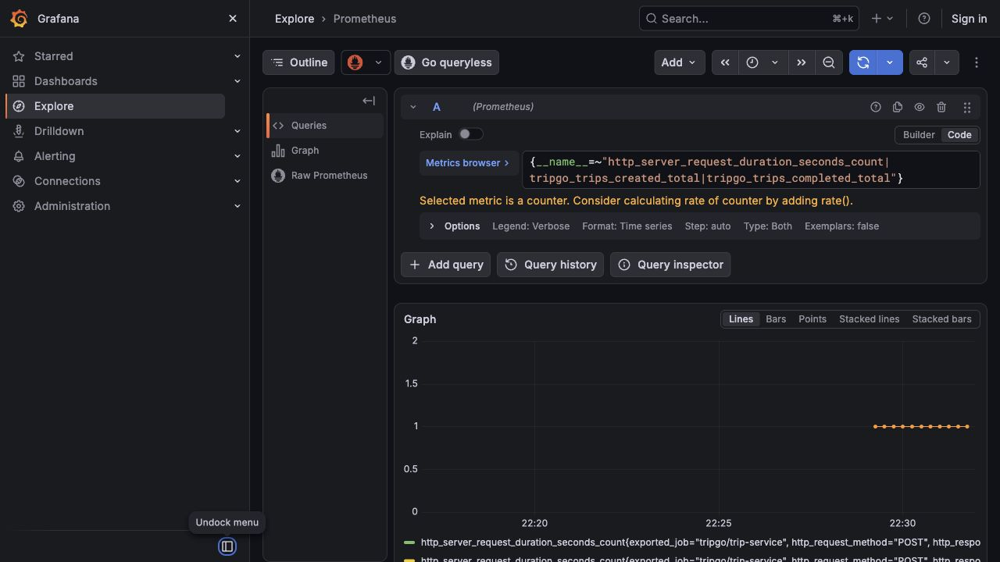

# Лабораторная работа 2

Слои: HTTP → usecase → domain/model; repository реализует интерфейсы usecase.
Конкретные реализации собираются вручную в container.

Решения:

- пакет на действие, интерфейсы у потребителя;
- доменный переход `Finish` под блокировкой `SELECT FOR UPDATE`;
- единый маппинг ошибок, внутренние детали доступны только в логах;
- контекстный TxManager с ограниченными по времени begin/commit/rollback;
- OTel через OTLP, логгер с корреляцией trace/span ID;
- изолированная схема PostgreSQL на каждый интеграционный тест.

Проверки:

- `make lint`: 0 замечаний;
- `make test`: `-race -count=2`, domain — 95,5%, usecase — 100%;
- `make test-integration`: реальный PostgreSQL, `-race -count=2`;
- HTTP create → `201`, finish → `200`;
- при остановленном deployment `otel-collector` GET поездки вернул `200`;
- deployment коллектора восстановлен после проверки;
- trace ID из JSON-лога найден в Jaeger;
- метрики HTTP и бизнес-счётчики видны в Grafana Explore;
- контракт и миграции сохранены.

Трейс проверочного запроса: `320103218674a5725d185b1ebc6bbd80`.
В нём HTTP-спан и вложенные BEGIN, INSERT trips, INSERT trip_status_history, COMMIT.

